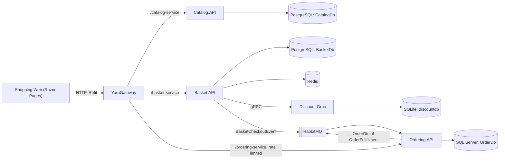

# Architecture — EShopMicroservices

Reference doc for AI coding loops working in the EShop repo: a .NET 8
microservices system (`src/Services`), a YARP API gateway
(`src/ApiGateways/YarpGateway`) and a Razor Pages web app
(`src/WebApps/Shopping.Web`). It summarises the system's structure so an agent
can find its way around without re-reading every source file. Behaviour that
differs from what the code suggests is collected in
[known pitfalls](kb/pages/eshop/pitfalls.md); the end-to-end checkout is in
[checkout flow](kb/pages/eshop/checkout.md).

All paths are relative to the repo root.

## Backend — `src/Services`

### System summary

Four independently deployable .NET 8 services, **each with its own database**:

| Service | Project | Role | Style | Store |
|---|---|---|---|---|
| Catalog | `Services/Catalog/Catalog.API` | Products: CRUD, by category, paging | Vertical slices (Carter + MediatR) | PostgreSQL via Marten (document DB) |
| Basket | `Services/Basket/Basket.API` | Shopping cart per user; applies discounts; starts checkout | Vertical slices | PostgreSQL via Marten, Redis cache in front |
| Discount | `Services/Discount/Discount.Grpc` | Coupons per product name | gRPC service | SQLite via EF Core |
| Ordering | `Services/Ordering/Ordering.{API,Application,Domain,Infrastructure}` | Orders: CRUD, queries, creates orders from checkout events | Clean Architecture + DDD | SQL Server via EF Core |

Edge and UI:

| Component | Project | Role |
|---|---|---|
| API gateway | `ApiGateways/YarpGateway` | YARP reverse proxy: one route per service, a rate limit on Ordering. See [gateway routes](kb/pages/eshop/gateway-routes.md) |
| Web app | `WebApps/Shopping.Web` | Razor Pages storefront; calls the backend only through the gateway, using Refit |

`ApiGateways/YarpApiGateway` is an unused leftover: it's not in the solution or in
docker-compose.

Shared `BuildingBlocks/` libraries:

| Library | Purpose |
|---|---|
| `BuildingBlocks` | CQRS interfaces (`ICommand`, `IQuery`, their handlers) over MediatR; pipeline behaviours `ValidationBehavior<,>` and `LoggingBehavior<,>`; exceptions (`NotFoundException`, `BadRequestException`, `InternalServerException`); `CustomExceptionHandler`, which turns them into `ProblemDetails`; `PaginationRequest` / `PaginatedResult` |
| `BuildingBlocks.Messaging` | Integration events (`IntegrationEvent`, `BasketCheckoutEvent`) and `AddMessageBroker()`, which sets up MassTransit on RabbitMQ |

### System diagram



### Request flow

HTTP endpoints are Carter modules (`ICarterModule`, Minimal APIs) and stay thin:
they map the request to a command or query with Mapster, send it through
MediatR, and map the result to a response.

```
HTTP request → Carter endpoint (ICarterModule.AddRoutes)
            → request.Adapt<Command/Query>() → ISender.Send(...)
            → pipeline behaviours (ValidationBehavior, LoggingBehavior)
            → handler
                Catalog / Basket: IDocumentSession or IBasketRepository → Marten → PostgreSQL
                Ordering:         IApplicationDbContext → EF Core → SQL Server
            → result.Adapt<Response>() → Results.Ok / Results.Created
```

Where the code lives depends on the service:

- **Catalog and Basket: vertical slices.** One folder per feature, holding the
  endpoint, request/response, command/query, validator and handler, for example
  `Services/Catalog/Catalog.API/Products/CreateProduct/{CreateProductEndpoint,CreateProductHandler}.cs`.
- **Ordering: Clean Architecture.** Four projects, with dependencies pointing inward:
  - `Ordering.Domain`: the `Order` aggregate, entities, value objects and domain events. No dependencies.
  - `Ordering.Application`: commands, queries and handlers (`Orders/Commands/*`,
    `Orders/Queries/*`), DTOs, event handlers, and the `IApplicationDbContext` abstraction.
  - `Ordering.Infrastructure`: `ApplicationDbContext`, entity configurations, interceptors, migrations and seed data.
  - `Ordering.API`: Carter endpoints (`Endpoints/*.cs`) and wiring. Each layer
    registers itself through a `DependencyInjection.cs` extension
    (`AddApplicationServices`, `AddInfrastructureServices`, `AddApiServices`).

Cross-cutting concerns run as MediatR pipeline behaviours, registered in each
service with `config.AddOpenBehavior(...)`:

- `ValidationBehavior<,>` runs FluentValidation validators on **commands only**
  (it's constrained to `ICommand<TResponse>`). Only Catalog registers its
  validators (`AddValidatorsFromAssembly`, `Services/Catalog/Catalog.API/Program.cs:14`),
  so Basket and Ordering validators never run (see [pitfalls](kb/pages/eshop/pitfalls.md)).
- `LoggingBehavior<,>` logs the start and end of each request, and logs a warning when a request takes over 3 seconds.

Failures surface as exceptions. `CustomExceptionHandler`
(`BuildingBlocks/Exceptions/Handler/CustomExceptionHandler.cs`) maps them to
`ProblemDetails` with a `traceId`:

| Exception | HTTP status |
|---|---|
| `ValidationException`, `BadRequestException` | 400 (validation errors under `ValidationErrors`) |
| `NotFoundException` and subclasses (`ProductNotFoundException`, `BasketNotFoundException`, `OrderNotFoundException`) | 404 |
| anything else | 500 |

Catalog, Basket and Ordering register this handler. Discount reports errors as
gRPC `RpcException` statuses (`InvalidArgument`, `NotFound`).

Health checks: Catalog, Basket and Ordering expose `/health` (HealthChecks UI JSON
writer) and check their database; Basket checks Redis too. Discount, the
gateway and the web app have no health endpoint.

### Data layer

Database per service: no service reads another service's store.

| Service | Access | Schema / migrations | Seed |
|---|---|---|---|
| Catalog | Marten `IDocumentSession` (lightweight sessions); `Product` stored as a JSON document | Marten manages its own tables; no migrations in the repo | `InitializeMartenWith<CatalogInitialData>()`, Development only (`Program.cs:23-24`) |
| Basket | `IBasketRepository` → `BasketRepository` (Marten), wrapped by `CachedBasketRepository` (Scrutor `Decorate`, `Program.cs:27-28`); `ShoppingCart` keyed by `UserName` | Marten | none |
| Discount | EF Core `DiscountContext` on SQLite | EF migrations in `Discount.Grpc/Migrations`, applied at startup by `UseMigration()` (not awaited, see [pitfalls](kb/pages/eshop/pitfalls.md)) | seeded in the model (`HasData`) |
| Ordering | EF Core `ApplicationDbContext` behind `IApplicationDbContext` | EF migrations in `Ordering.Infrastructure/Data/Migrations`, applied at startup **in Development only** by `InitialiseDatabaseAsync()` | `InitialData` (customers, products, orders) when the tables are empty |

The Redis cache is cache-aside, keyed by user name: reads try Redis and fall back
to Postgres, filling the cache on a miss; writes and deletes update Postgres and
then Redis.

The Ordering domain model:

- Strongly typed IDs (`OrderId`, `CustomerId`, `ProductId`, `OrderItemId`) are
  records with an `Of(...)` factory that rejects empty values (`DomainException`);
  EF maps them with `HasConversion`.
- `Address`, `Payment` and `OrderName` are value objects; `Address` and `Payment`
  are mapped as EF Core 8 complex types (`ComplexProperty`, `OrderConfiguration.cs`).
- `Order` is the aggregate root (`Aggregate<OrderId>`): private setters, an
  `Order.Create(...)` factory, and `Add`/`Remove`/`Update` methods. `TotalPrice` is
  computed from the items.
- Two `SaveChangesInterceptor`s: `AuditableEntityInterceptor` fills the
  created/modified fields, and `DispatchDomainEventsInterceptor` publishes the
  aggregates' domain events through MediatR **before** the save
  (`Data/Interceptors/`).

### Service-to-service communication

| From → to | Kind | How |
|---|---|---|
| Web → services | Sync HTTP | Refit clients (`ICatalogService`, `IBasketService`, `IOrderingService`) → YARP gateway |
| Basket → Discount | Sync gRPC | `DiscountProtoService` client generated from `Discount.Grpc/Protos/discount.proto`; one `GetDiscount` call per basket item on store. The client accepts any TLS certificate (`Program.cs:41-50`) |
| Basket → Ordering | Async, RabbitMQ | Checkout publishes `BasketCheckoutEvent` through MassTransit `IPublishEndpoint`; Ordering's `BasketCheckoutEventHandler` consumes it and sends `CreateOrderCommand` |
| Ordering → (nobody) | Async, RabbitMQ | `OrderCreatedEventHandler` publishes the order as `OrderDto` when the `OrderFullfilment` feature flag is on. No consumer exists yet |

`AddMessageBroker(configuration, assembly?)`
(`BuildingBlocks/BuildingBlocks.Messaging/MassTransit/Extentions.cs`) uses
kebab-case endpoint names and registers consumers from the given assembly.
Basket passes none (it only publishes); Ordering passes `Ordering.Application`.
There is no outbox and no retry policy configured.

The full checkout sequence, with line references and failure cases, is in
[checkout flow](kb/pages/eshop/checkout.md).

### Domain events vs integration events

- **Domain events** (`OrderCreatedEvent`, `OrderUpdatedEvent`) are in-process
  MediatR notifications (`IDomainEvent : INotification`). They're raised by the
  aggregate, dispatched by the interceptor, and handled in
  `Ordering.Application/Orders/EventHandlers/Domain/`.
- **Integration events** (`BasketCheckoutEvent : IntegrationEvent`, plus
  `OrderDto`) cross service boundaries over RabbitMQ. They're handled in
  `Ordering.Application/Orders/EventHandlers/Integration/`.

A domain event handler can turn into an integration event (`OrderCreatedEventHandler`
→ `OrderDto`), which is where the feature flag (`Microsoft.FeatureManagement`,
`IFeatureManager`) sits.

### AuthN / AuthZ

None. No service, the gateway or the web app authenticates or authorises
requests. The web app uses a hardcoded user (`swn`) and customer ID (see
[pitfalls](kb/pages/eshop/pitfalls.md)). The gateway's only protection is the
rate limit on the ordering route.

### Background jobs

None scheduled. All asynchronous work is message-driven: MassTransit consumers
in Ordering, started by the RabbitMQ bus.

### Runtime / deployment

Local orchestration is one Docker Compose project, `src/docker-compose.yml` plus
`src/docker-compose.override.yml` (environment, ports, volumes); it is also a
Visual Studio `docker-compose.dcproj`. Each service has a multi-stage
`Dockerfile` on `mcr.microsoft.com/dotnet/aspnet:8.0`, built from the `src/`
context.

| Container | Image | Host ports (HTTP / HTTPS) |
|---|---|---|
| `catalogdb` | `postgres` (volume `postgres_catalog`) | 5432 |
| `basketdb` | `postgres` (volume `postgres_basket`) | 5433 |
| `distributedcache` | `redis` | 6379 |
| `orderdb` | `mcr.microsoft.com/mssql/server` (no volume) | 1433 |
| `messagebroker` (host name `ecommerce-mq`) | `rabbitmq:management` | 5672, UI 15672 |
| `catalog.api` | build | 6000 / 6060 |
| `basket.api` | build | 6001 / 6061 |
| `discount.grpc` | build | 6002 / 6062 |
| `ordering.api` | build | 6003 / 6063 |
| `yarapipgateway` (spelled this way) | build | 6004 / 6064 |
| `shopping.web` | build | 6005 / 6065 |

Every app container runs with `ASPNETCORE_ENVIRONMENT=Development` (so seeding and
Ordering's migrations run), listens on 8080/8081 inside, and mounts the host's
user secrets and dev HTTPS certificate read-only.

There is no CI pipeline, no deployment definition beyond Compose, and **no test
projects** in the repo.

### Configuration

Each service reads `appsettings.json`, overridden by environment variables in
`docker-compose.override.yml` (`Section__Key`). The `appsettings.json` values
point at `localhost` for running outside Docker. Key sections:

```json
{
  "ConnectionStrings": { "Database": "...", "Redis": "localhost:6379" },
  "GrpcSettings": { "DiscountUrl": "https://localhost:5052" },
  "MessageBroker": { "Host": "amqp://localhost:5672", "UserName": "guest", "Password": "guest" },
  "FeatureManagement": { "OrderFullfilment": false },
  "ApiSettings": { "GatewayAddress": "https://localhost:6064" },
  "ReverseProxy": { "Routes": { "...": {} }, "Clusters": { "...": {} } },
  "Kestrel": { "EndpointDefaults": { "Protocols": "Http2" } }
}
```

| Section | Used by |
|---|---|
| `ConnectionStrings:Database` | all four services |
| `ConnectionStrings:Redis`, `GrpcSettings:DiscountUrl` | Basket |
| `MessageBroker:*` | Basket, Ordering |
| `FeatureManagement:OrderFullfilment` | Ordering (`false` locally, `true` in Docker) |
| `ApiSettings:GatewayAddress` | Shopping.Web |
| `ReverseProxy` | YarpGateway |
| `Kestrel:EndpointDefaults:Protocols = Http2` | Discount (gRPC) |

Options are read directly from `IConfiguration` (`configuration["Section:Key"]`),
not bound to options classes. Secrets (database and broker passwords) are plain
values in `appsettings.json` and the compose file.

## Frontend — `src/WebApps/Shopping.Web`

### Structure

```
Pages/                    # Razor Pages, one PageModel each
  Index, ProductList, ProductDetail   # catalog browsing, add to cart
  Cart, Checkout, Confirmation        # basket and checkout
  OrderList                           # orders of the (hardcoded) customer
  Contact, Privacy, Error
  Shared/                 # _Layout, product partials, validation scripts
Models/                   # DTOs per backend: Catalog/, Basket/, Ordering/
Services/                 # Refit interfaces: ICatalogService, IBasketService, IOrderingService
wwwroot/                  # static assets (Bootstrap template)
```

### API layer

Three Refit interfaces, registered with `AddRefitClient<T>()` and sharing the base
address `ApiSettings:GatewayAddress` (`Program.cs:7-23`). Each route includes its
gateway prefix, for example `[Post("/basket-service/basket/checkout")]`.
`IBasketService.LoadUserBasket()` (a default interface method) returns the user's
basket, or an empty one when Basket answers 404.

### Rendering and state

Server-side rendering only: no SPA, no JavaScript framework. There's no session or
login; the user is always `swn`.

## Repository structure map

| Area | Holds |
|---|---|
| `src/Services/` | The four services: `Catalog/`, `Basket/`, `Discount/`, `Ordering/` (4 projects) |
| `src/BuildingBlocks/` | Shared libraries: `BuildingBlocks`, `BuildingBlocks.Messaging` |
| `src/ApiGateways/` | `YarpGateway` (in use), `YarpApiGateway` (leftover) |
| `src/WebApps/` | `Shopping.Web` |
| `src/` root | `eshop-microservices.sln`, `docker-compose.yml`, `docker-compose.override.yml`, `docker-compose.dcproj` |
| `docs/` | `ARCHITECTURE.md` (this map); `kb/` — knowledge base: `pages/eshop/` (reviewed pages, loaded into gbrain), `RUNBOOK.md` (how the KB is built), `_verification/` (evaluation notes and scripts) |
| `.claude/` | `settings.json` and `hooks/check-gstack.cjs` (gstack gate); `skills/` (TDD, API design, ADRs, observability, constraints) and `references/`; versions in `skills-lock.json` |
| root files | `README.md`, `CLAUDE.md` (AI entry point: gstack and gbrain guidance), `LICENSE` |

## Further reading

- [Gateway routes](kb/pages/eshop/gateway-routes.md): every public endpoint, ports, the rate limit
- [Checkout flow](kb/pages/eshop/checkout.md): Web → Basket → RabbitMQ → Ordering, with failure cases
- [Known pitfalls](kb/pages/eshop/pitfalls.md): behaviour that differs from what the code suggests
- Run locally: `docker compose -f src/docker-compose.yml -f src/docker-compose.override.yml up -d`, then open `http://localhost:6005`
