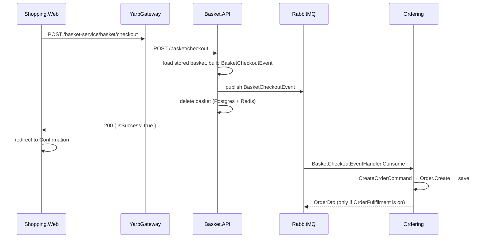

# Basket checkout flow

What happens from the moment a user submits the checkout form until an order
exists. Checkout crosses three services: the web app calls Basket over HTTP
(through the gateway), and Basket hands the order to Ordering through RabbitMQ.
The web app shows "order submitted" as soon as Basket has published the
message; the order itself is created later and asynchronously.

All paths are relative to the repo root. See also [known pitfalls](pitfalls.md)
and [gateway routes](gateway-routes.md).

## Overview

## Step by step

### 1. Web app: checkout page

`src/WebApps/Shopping.Web/Pages/Checkout.cshtml.cs`

1. `OnPostCheckOutAsync` (`:16`) reloads the user's basket (`:19`).
2. If the form is invalid, the page is shown again (`:20-23`).
   `BasketCheckoutModel` has no validation attributes, so only type binding is checked.
3. It sets a hardcoded customer ID, the basket's user name and total price
   (`:25-27`). The user is always `swn` (`src/WebApps/Shopping.Web/Services/IBasketService.cs:22`).
4. It posts the form through the Refit client (`:29`):
   `POST /basket-service/basket/checkout` (`IBasketService.cs:16-17`).
5. It redirects to the confirmation page (`:31`), which shows
   "Your order submitted successfully." (`src/WebApps/Shopping.Web/Pages/Confirmation.cshtml.cs:14`).

### 2. Gateway

`basket-route` strips `/basket-service` and forwards to Basket
(`src/ApiGateways/YarpGateway/appsettings.json:18-24`). Not rate limited.

### 3. Basket: endpoint and handler

Endpoint: `src/Services/Basket/Basket.API/Basket/CheckoutBasket/CheckoutBasketEndpoints.cs:10-18`.
It maps the request to `CheckoutBasketCommand`, sends it through MediatR, and
returns **HTTP 200** with `{ isSuccess }` (`Results.Ok`, `:18`). The endpoint's
metadata declares 201 (`:21`), which is wrong.

Handler: `CheckoutBasketCommandHandler.Handle` in
`src/Services/Basket/Basket.API/Basket/CheckoutBasket/CheckoutBasketHandler.cs:25-46`:

| Line | What it does |
|---|---|
| `:32` | Loads the stored basket by user name (Redis first, then Postgres) |
| `:33-36` | Null check that never runs: a missing basket throws `BasketNotFoundException` instead, so the caller gets **404** |
| `:38` | Maps the checkout form to `BasketCheckoutEvent` (Mapster) |
| `:39` | Sets `TotalPrice` from the **stored** basket, not from the form. The total is computed from the items (`src/Services/Basket/Basket.API/Models/ShoppingCart.cs:7`) |
| `:41` | Publishes the event to RabbitMQ (MassTransit `IPublishEndpoint`) |
| `:43` | Deletes the basket from Postgres and Redis |

The validator (`:11-19`) requires the form and a user name, but Basket never
registers its validators, so it doesn't run (see [pitfalls](pitfalls.md)).

### 4. The message: `BasketCheckoutEvent`

`src/BuildingBlocks/BuildingBlocks.Messaging/Events/BasketCheckoutEvent.cs:4-22`:
user name, customer ID, total price, one address (name, email, address line,
country, state, zip), and card details including the CVV.

**It carries no basket items.**

Broker setup is shared: `AddMessageBroker`
(`src/BuildingBlocks/BuildingBlocks.Messaging/MassTransit/Extentions.cs:9-31`).
Basket registers no consumers (`src/Services/Basket/Basket.API/Program.cs:53`);
Ordering registers the consumers in its Application assembly
(`src/Services/Ordering/Ordering.Application/DependencyInjection.cs:22`).

### 5. Ordering: consumer

`BasketCheckoutEventHandler` in
`src/Services/Ordering/Ordering.Application/Orders/EventHandlers/Integration/BasketCheckoutEventHandler.cs`:

- `Consume` (`:10-17`) maps the event to `CreateOrderCommand` and sends it through MediatR.
- `MapToCreateOrderCommand` (`:19-41`):
  - a new order ID (`:24`), status `Pending` (`:33`);
  - the **same address is used for shipping and billing** (`:30-31`);
  - **2 hardcoded order items**, whatever was in the basket (`:34-38`).

### 6. Ordering: creating the order

`CreateOrderHandler` in
`src/Services/Ordering/Ordering.Application/Orders/Commands/CreateOrder/CreateOrderHandler.cs:5-38`:

1. Builds the `Address` and `Payment` value objects (`:21-22`, `:30`) and calls
   `Order.Create` (`:24-31`), which raises `OrderCreatedEvent`
   (`src/Services/Ordering/Ordering.Domain/Models/Order.cs:32`).
2. Adds each item with `order.Add` (`:33-36`).
3. Saves it (`:13-14`). While saving, `DispatchDomainEventsInterceptor` sends
   the domain events through MediatR **before** the database write
   (`src/Services/Ordering/Ordering.Infrastructure/Data/Interceptors/DispatchDomainEventsInterceptor.cs:14-18`).

### 7. Ordering: optional `OrderDto` publish

`OrderCreatedEventHandler`
(`src/Services/Ordering/Ordering.Application/Orders/EventHandlers/Domain/OrderCreatedEventHandler.cs:13-17`)
publishes the order as `OrderDto` to RabbitMQ only if `OrderFullfilment` is on.
It's off in `appsettings.json` and on in Docker. Nothing consumes `OrderDto`.

## How checkout can fail

| Where | What happens | Seen by the user? |
|---|---|---|
| No stored basket | Basket throws `BasketNotFoundException`, HTTP 404 | Yes (the Refit call throws) |
| Ordering can't build the value objects: an empty email or address line (`src/Services/Ordering/Ordering.Domain/ValueObjects/Address.cs:28-29`), or a CVV longer than 3 characters (`src/Services/Ordering/Ordering.Domain/ValueObjects/Payment.cs:28`) | The consumer throws. Nothing validates these earlier, so the user has already seen "order submitted". **Not runtime-tested**; with no retry policy configured, MassTransit's default would move the message to an error queue (**UNVERIFIED**) | **No**, and the basket is already deleted |
| Publish succeeds, basket delete fails | A retry publishes the checkout again; Ordering has no duplicate check | No |
| Ordering save fails after the domain events ran | With the flag on, `OrderDto` may already be on RabbitMQ for an order that doesn't exist | No |
